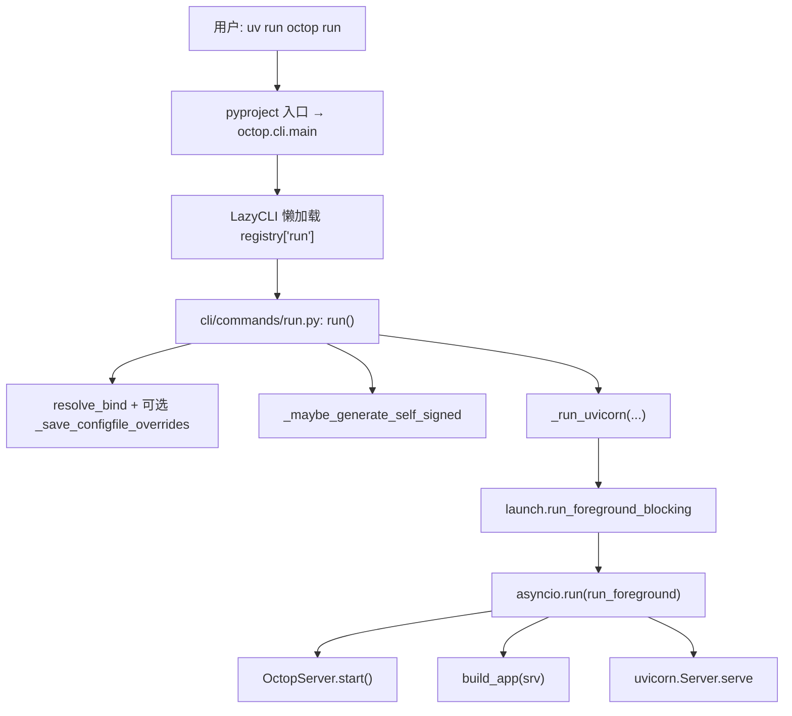

# 精读：`launch.py` 与 `cli/commands/run.py` 的调用关系

面向阶段 0～1：搞清楚「在终端敲 `octop run` 之后，Python 里到底发生了什么」。

> 官方源码根：`D:\study\Octop\Octop-main`。本实验室：`D:\study\Octop\octop-mini`（课程 01 见 [README](./README.md)）。

---

## 1. 一句话结论

| 模块 | 角色 | 比喻 |
|------|------|------|
| `cli/commands/run.py` | **前台服务员**：解析参数、读/写 `config.json`、处理 CLI 式 TLS | 点菜、记桌号 |
| `octop/launch.py` | **组合根（Composition Root）**：启动领域服、拼 FastAPI、拉起 uvicorn、优雅退出 | 开火、上菜、收台 |

**唯一跨层调用点**：`run.py` 里的 `_run_uvicorn()` → `launch.run_foreground_blocking()` → `asyncio.run(run_foreground(...))`。

`infra/` 和 `api/` 都不会被 CLI **直接** import；HTTP 与领域的合拢只允许发生在 `launch.py`（见 `AGENTS.md`）。

---

## 2. 从终端到监听的完整调用链



### 2.1 CLI 入口（你不用先读，知道路径即可）

1. 包入口在 `pyproject.toml` 的 `[project.scripts]`，指向 `octop.cli.main:cli`。
2. `cli/main.py` 的 `_LazyCLI` 只有在执行子命令时才 `import` 对应模块。
3. `cli/registry.py` 注册：`"run" → (".commands.run", "run", ...)`，即 **函数名也叫 `run`** 的 Click 命令。

---

## 3. `run.py` 做什么（CLI 层职责）

文件：`src/octop/cli/commands/run.py`

### 3.1 Click 命令与参数

`@click.command("run")` 暴露：

| 参数 | 传给 launch | 说明 |
|------|-------------|------|
| `--host` | `host` | 绑定地址 |
| `--port` | `port` | 0～65535（0 表示 OS 分配端口） |
| `--reload` | `reload` | 开发热重载 |
| `--workers` | `workers` | 进程数（TLS 双端口时会强制为 1） |
| `--log-level` | `log_level` | 覆盖 config |
| `--ssl` / cert / key | 经 `_maybe_generate_self_signed` → `ssl_certfile` / `ssl_keyfile` | CLI 自签；config 里 TLS 由 launch 另读 |

### 3.2 绑定地址优先级（重要）

`resolve_bind()` 合并顺序（**越靠前越优先**）：

1. 本次 CLI 的 `--host` / `--port`
2. 环境变量（`env_bind_overrides()`：`OCTOP_BIND_HOST`、`OCTOP_PORT` 等）
3. `~/.octop/config.json` 的 `bind_host`（或旧键 `host`）与 `port`

若你在命令行传了 `--host` 或 `--port`，还会在启动 uvicorn **之前** 调用 `_save_configfile_overrides()` **写回** `config.json`（合并写入， corrupt 的 json 会直接失败，避免 silent wipe）。

### 3.3 为何有 `_run_uvicorn()` 这一层？

```18:22:src/octop/cli/commands/run.py
def _run_uvicorn(**kwargs: object) -> None:
    """Indirection seam for tests; the real implementation runs uvicorn."""
    from octop.launch import run_foreground_blocking

    run_foreground_blocking(**kwargs)
```

- **延迟 import**：避免 CLI 帮助、补全等场景就把 uvicorn / 整条启动链拉进来。
- **测试缝**：单测可以 patch `_run_uvicorn`，不必真起服务。

### 3.4 `run()` 主流程（按执行顺序）

1. `resolve_bind` → 得到最终 `host` / `port`
2. 若 CLI 显式传了 host/port → 持久化到 `config.json`
3. `_maybe_generate_self_signed`（仅 `--ssl` 且未给证书时生成到 `~/.octop/ssl/`）
4. `_run_uvicorn(host=..., port=..., reload=..., workers=..., log_level=..., ssl_*)`

**刻意不做的事**：不创建 `OctopServer`、不注册 FastAPI 路由——全部交给 `launch.py`。

---

## 4. `launch.py` 做什么（组合根职责）

文件：`src/octop/launch.py`  
docstring 已点题：*wire OctopServer, FastAPI, and uvicorn for `octop run`*.

### 4.1 同步入口

```183:185:src/octop/launch.py
def run_foreground_blocking(**kwargs: Any) -> None:
    """Sync entry for Click commands and tests."""
    asyncio.run(run_foreground(**kwargs))
```

Click 命令是同步的，因此用 `asyncio.run` 包一层；测试、其它脚本也可直接调这两个函数。

### 4.2 `run_foreground()` 分段解读

建议对照源码分 **6 段** 阅读：

| 段 | 大致行号 | 动作 |
|----|----------|------|
| ① 启动领域 | 86～88 | `OctopServer()` → `await srv.start()`（DB、Agent、Gateway、Cron…） |
| ② 旁路任务 | 88 | Linux 上后台 `bubblewrap` 预配（失败不杀进程） |
| ③ 解析监听 | 90～108 | 合并 CLI 的 host/port 与 `cfg`；桌面壳、TLS 路径、`build_listen_plan` |
| ④ 构建 HTTP | 117 | `build_app(srv)` — **此处 import `api/app.py`** |
| ⑤ 起 uvicorn | 120～168 | 单端口或 HTTPS+HTTP 伴生（ACME/重定向） |
| ⑥ 运行与收尾 | 172～180 | `MemorySlimControl`；`gather(serve)`；`finally` 里 `srv.stop()` |

核心片段（启动 + 建 app）：

```86:117:src/octop/launch.py
    srv = OctopServer()
    await srv.start()
    bwrap_task = _schedule_linux_bubblewrap_ensure()
    # ...
    cfg = srv.services.config if srv.services is not None else srv.config
    assert cfg is not None
    bind_host = host or cfg.bind_host
    bind_port = port or cfg.port
    # ... TLS / listen plan ...
    app = build_app(srv)
```

**注意 host/port 的二次合并**：

- CLI 已在 `run.py` 里 `resolve_bind` 过一次；
- `launch` 里 `bind_host = host or cfg.bind_host`：若传入 `None`，再用 **已加载到 server 上的 config**。

通常 CLI 会传入解析后的值；直连 `run_foreground_blocking()` 的测试可能只依赖 `cfg`。

### 4.3 WebSocket 与 uvicorn 参数

模块顶部常量调大了 WS 保活容错（云协作场景），并传入 `uvicorn.Config`：

- `ws_max_size=BRIDGE_WS_MAX_BYTES`
- `ws_ping_interval=20`，`ws_ping_timeout=None`（迟到的 pong 不断连）

### 4.4 关闭顺序（finally）

1. `memory_control.close()`
2. 取消 Linux bwrap 后台任务
3. `await srv.stop()` — 释放 DB、Gateway、Agent 等

这是「单进程」优雅退出路径；Ctrl+C 也应走类似清理（由 asyncio/uvicorn 驱动到 finally）。

---

## 5. 两文件参数对照表

|  Concern | `run.py` | `launch.py` |
|----------|----------|-------------|
| 解析 bind 优先级 CLI > env > file | ✅ `resolve_bind` | 使用传入值或 `cfg` |
| 写回 `config.json` 的 host/port | ✅ 仅 CLI 显式传参时 | ❌ |
| CLI `--ssl` 自签证书 | ✅ `_maybe_generate_self_signed` | 还可读 `cfg.tls` + `resolve_tls_paths` |
| 创建 `OctopServer` | ❌ | ✅ |
| `build_app` | ❌ | ✅ |
| uvicorn workers/reload | 传参 | TLS 双听时可能强制 `workers=1`、`reload=False` |

---

## 6. 与架构边界的对应

```
cli/commands/run.py  ──imports──►  launch.py
                                      ├── infra/server.py (OctopServer)
                                      └── api/app.py (build_app)

infra/*  ──X──►  api/*   (禁止)
cli/*    ──X──►  api/*   (禁止；经 launch 绕一圈)
```

因此：

- 读「业务怎么启动」→ `infra/server.py` 的 `OctopServer.start()`
- 读「HTTP 怎么挂上」→ `launch.py` + `api/app.py`
- 读「用户怎么敲命令」→ `cli/commands/run.py`

---

## 7. 自测题（建议做完再进入阶段 1 后半）

1. 只改 `config.json` 的 `port`、不传 CLI，重启后端口从哪读？（提示：两处都可能读到。）
2. `enable_dashboard` / `enable_api_docs` 在哪生效？（答：`build_app`，在 `launch` 调用之后。）
3. 为何 AGENTS 说只有 `launch.py` 可同时 import `infra` 与 `api`？
4. 单测若想测 `octop run` 而不真监听端口，应 patch 哪个函数？

参考答案要点：1 → `resolve_bind` + `srv.start()` 已加载的 cfg；2 → `api/app.py`；3 → 防循环依赖、组合根；4 → `_run_uvicorn` 或 `run_foreground_blocking`。

---

## 8. 建议断点 / 日志观察（可选调试）

在本地开发时可在以下位置打断点或加临时 log（学完记得删）：

| 顺序 | 位置 | 观察变量 |
|------|------|----------|
| 1 | `run.run()` 入口 | `cli_host`, `cli_port`, `resolve_bind` 结果 |
| 2 | `run_foreground` 刚 `start()` 后 | `srv.services is not None`、`cfg.port` |
| 3 | `build_app` 返回后 | `enable_dashboard`, `enable_api_docs` |
| 4 | uvicorn 启动前 | `plan.bind_host`, `plan.http_port` / `https_port` |

---

## 9. 相关文件索引

| 文件 | 关系 |
|------|------|
| `cli/registry.py` | 注册 `run` 子命令 |
| `cli/main.py` | Click 根组、懒加载 |
| `config.py` | `OctopConfig`、`env_bind_overrides` |
| `infra/utils/paths.py` | `PathLayout`、`config.json` 路径 |
| `infra/server.py` | `OctopServer.start()` / `stop()` |
| `api/app.py` | `build_app(server)` |
| `docs/architecture.md` §2 | 官方进程模型说明 |

---

## 10. 下一步阅读顺序

1. `infra/server.py` — `start()` 前半（DB + SharedServices）  
2. `api/app.py` — `build_app` 中间件与路由挂载  
3. 回到 [02-章末复习.md](./02-章末复习.md) 做实验 B、C  

在对话中说 **「精读 server.start 前半」** 可继续生成 `精读-02-OctopServer-start.md`。