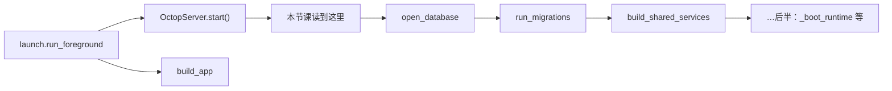

# 微课 1.6：`OctopServer.start()` 第一段 — 学习说明

**时长**：约 45～60 分钟  
**类型**：**官方跟读 + mini 实现控制平面启动前段**（`open_database` → `migrate` → `SharedServices`）  
**先修**：微课 1.5 完成（`cli` → `launch` 已理解）  

---

## 1. 本节要回答的问题

学完应能说明：

1. `launch.py` 里 `await srv.start()` 之后，**在 HTTP 监听之前**，领域层至少做了哪几件大事？  
2. **控制平面数据库**何时打开、迁移在哪一行附近发生？  
3. `SharedServices` 是什么、和 `OctopServer.services` 什么关系？  
4. 什么是 **deferred DB**（向导未选库就 return）— 和正常路径有何不同？  

---

## 2. 在启动总图里的位置

打开 Octop-main：

`D:\study\Octop\Octop-main\docs\teaching\06-数据流与关键序列图.md` → **§1 进程启动**

你已在 1.5 标过：`CLI` → `launch` → **`OctopServer.start()`** → `build_app` → uvicorn。  
**本节只深耕 `start()` 的前半段**，不要一口气读到 Gateway / AgentManager（那是 §1.4 的第 2～4 段）。



---

## 3. 必读文件（按阅读顺序）

| 顺序 | 文件 | 读到哪 / 看什么 |
|------|------|-----------------|
| ① | `src/octop/infra/server.py` | `class OctopServer` 类属性概览（`paths`、`services`、`config`） |
| ② | 同上 | `async def start` **从函数入口到** `build_shared_services(...)` ** inclusive** |
| ③ | `src/octop/infra/utils/paths.py` | 对照 `self.paths` 有哪些目录（和 mini 的 `PathLayout` 对照） |
| ④ | `src/octop/infra/db/factory.py` | `open_database` **函数签名 + 分支**（SQLite / PG） |
| ⑤ | `src/octop/infra/db/migrate.py` | `run_migrations` 做什么（版本水印） |
| ⑥ | `src/octop/infra/db/services.py` | `build_shared_services` 返回什么（Repo 从哪拿） |

行号会随版本变动；以 **符号名** 为准。当前仓库里 `start()` 约在 **398 行** 起，迁移在 **`open_database` → `run_migrations` → `build_shared_services`** 三连附近。

---

## 4. `start()` 前半 chronology（建议做笔记）

按**真实执行顺序**（不是 phase 文档里的简化三步）：

| 步骤 | 代码在做什么 | mini 有吗 |
|------|----------------|----------|
| 1 | `paths.ensure_root()` | ✅ `PathLayout.ensure_root` |
| 2 | env 文件、日志、`config = load…(paths.config)` | ✅ 部分（无插件/专家目录） |
| 3 | ExpertCatalog / PluginManager 等 **DB 前** 初始化 | ❌ 课程 02+ |
| 4 | `should_defer_control_plane_db` → **可能提前 return** | ❌ |
| 5 | `open_database(config, paths)` | ✅ `infra/db/factory.py` |
| 6 | `run_migrations(db)` | ✅ `infra/db/migrate.py` |
| 7 | `build_shared_services(...)` → `self.services` | ✅ `infra/db/services.py` via `infra/boot.py` |

**本课验收重点**：能讲清 **5～7**，并知道 1～2 与 mini 的对应关系。

### 4.1 三个关键词（写进笔记）

用**自己的中文**各写一句：

- **`open_database`**：  
- **`run_migrations`**：  
- **`build_shared_services`**：  

### 4.2 deferred 分支（扫一眼即可）

若 `should_defer_control_plane_db` 为真：`start()` 在 **不打开 DB** 的情况下 `return`，留给 setup 向导后再 `bind_control_plane()`。  
不必现在读透向导，只要知道 **不是每次 start 都会执行 migrate**。

---

## 5. mini 对照（不编码，只联想）

| 官方 | octop-mini 今天 |
|------|-----------------|
| `OctopServer.start()` | `launch.run_foreground` 里的 `layout` + `load_config` + `MiniRuntime` |
| `self.services` | （尚无）→ 课程 02 加「迷你 Services + sqlite」 |
| `build_app(srv)` 依赖已 start 的 server | `build_app(runtime)` 已类似 |

学完 1.6 后应能接受：**launch 要等「领域启动」完成再 `build_app`**；mini 下一步就是在 `start` 等价位置 **打开 sqlite**。

---

## 6. 动手（不改代码）

### 6.1 标注启动图（15 min）

在 `06-数据流与关键序列图.md` 打印件或副本上，给 `Server->>DB: open_database + migrate` 旁边写上你读过的 **3 个文件名**。

### 6.2 观察本机 DB（10 min，可选）

若已 `octop init` 且非 deferred：

```powershell
# 看 octop.db 是否存在（路径以你的 OCTOP_HOME 为准）
dir $env:USERPROFILE\.octop\octop.db
```

用 SQLite 工具 `.tables` 扫一眼（不要求背表名）。

### 6.3 测试当文档（10 min，可选）

```powershell
cd D:\study\Octop\Octop-main
uv run pytest tests/unit/db/test_db_pool.py -q --maxfail=1
```

看失败/通过用例如何断言 **schema version**（与 `migrate.py` 呼应）。

---

## 7. 验收清单

- [ ] 能按顺序说出 `start()` 前半 **至少 5 步**（含 ensure_root、load config、open_database、migrate、build_shared_services）  
- [ ] 能解释 `SharedServices` 是 **repo + config 的 DI 袋**，挂在 `OctopServer.services`  
- [ ] 知道 **deferred DB** 是什么场景  
- [ ] 写完 §4.1 三句关键词 + [02-章末复习.md](./02-章末复习.md) §1.4 **第 1 段** 打勾  
- [ ] 对照图：`launch.py` 中 **`await srv.start()` 在 `build_app` 之前**  

**本节不要求**读懂 `_boot_runtime`、`AgentManager`、`Gateway`（留到 phase 1 章末或课程 02 前后补读）。

---

## 8. 自测题

1. 为何 migrate 必须在 `open_database` 之后、路由业务之前？  
2. 若删掉 `build_shared_services`，API 里 `Depends(get_server)` 还能拿到 repo 吗？  
3. mini 的 `MiniRuntime` 还缺官方 `OctopServer` 的哪两个字段级能力？（提示：`services`、`user_manager`）

参考答案要点：1 先有连接再改 schema；2 不能；3 持久化与 multi-user。

---

## 9. 下一节 / 下一课程

| 目标 | 文档 / 动作 |
|------|-------------|
| **课程 01 收尾** | [02-章末复习.md](./02-章末复习.md) 实验 A/B/C、§1.4 第 2～4 段（选修） |
| **课程 02 开始** | Octop-main `docs\teaching\lessons\phase-02-微课.md` |
| **mini M3** | 在 `launch` 里增加 `open sqlite` + migrate v1（将提供 `09-课程02-说明` 时再动代码） |

口令：**「开始课程 02」** 或 **「微课 1.6 带读 server」**。

---

## 10. mini 实现索引（1.6）

```text
src/mini/infra/boot.py              # boot_control_plane (≈ start 前半)
src/mini/infra/db/factory.py        # open_database
src/mini/infra/db/migrate.py        # run_migrations
src/mini/infra/db/migrations/001_initial.sql
src/mini/infra/db/services.py       # SharedServices
src/mini/launch.py                  # boot before build_app
```

验收：`uv run pytest tests/test_db.py -q`；`GET /health` 含 `db_bound: true`, `schema_version: 1`。

---

## 11. 相关索引

| 官方路径 |
|----------|
| `src/octop/infra/server.py` — `OctopServer.start` |
| `src/octop/infra/db/factory.py` |
| `src/octop/infra/db/migrate.py` |
| `src/octop/infra/db/services.py` |
| `docs/teaching/phases/phase-02-数据库与迁移.md` |